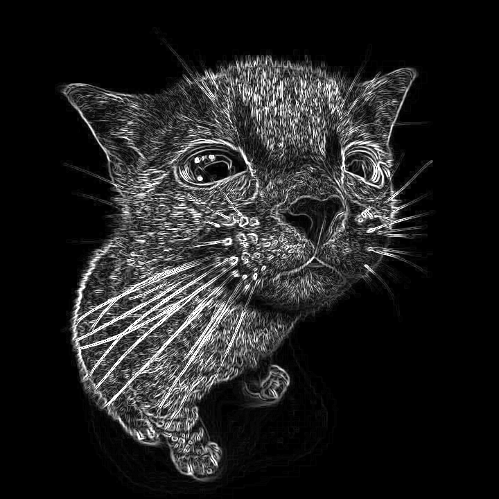

# Sobel Filter Implementation and Benchmark

Three different implementations of the Sobel edge-detection filter, and a benchmark that compares them.

## What is the Sobel filter?

The Sobel filter is an edge-detection operator used in image processing and computer vision. It works by calculating an approximation of the gradient of image intensity (areas where brightness changes sharply are identified as edges).

It convolves the image with two 3×3 kernels:

```
        Gx (vertical edges)          Gy (horizontal edges)
        ┌─────────────┐              ┌─────────────┐
        │ -1   0   1  │              │ -1  -2  -1  │
        │ -2   0   2  │              │  0   0   0  │
        │ -1   0   1  │              │  1   2   1  │
        └─────────────┘              └─────────────┘
```

For each pixel, the gradient magnitude is computed as: `√(Gx² + Gy²)` (large magnitude = strong edge, small magnitude = flat region).

## Example

| Input | Output |
|:-----:|:------------:|
|  |  |

## The three versions

All produce the same output, they differ only in structure.

- **`v1`**: nested loops over the 3×3 kernel.
- **`v2`**: unrolled kernels + cached row pointers + direct `outRow[col]` indexing instead of `Mat::at`.
- **`v3`**: separable, computes the 1D derivatives once and reuses the loaded pixels for both `Gx` and `Gy`, applying the `[1, 2, 1]` smoothing weights at the end. 

All three use OpenMP to parallelize across rows and expose the same interface:

```cpp
namespace sobel_vN {
    cv::Mat apply_sobel(const cv::Mat& input);
}
```

Each version contains only the algorithm, the image loading is identical for all three versions, so it is implemented once in a shared module:

```cpp
namespace image_io {
    cv::Mat load_grayscale(const std::string& path);
}
```

## Layout

```
.
├── common/image_io.{h,cpp}  # shared loader
├── media                    # sample input and output
├── v1/sobel_v1.{h,cpp}
├── v2/sobel_v2.{h,cpp}
├── v3/sobel_v3.{h,cpp}
├── benchmark.cpp            # benchmark:  <input> [iterations]
├── main.cpp                 # main:       <input> <output>
├── Makefile
└── README.md
```

## Requirements

- C++17 compiler, OpenCV ≥ 4, OpenMP, `pkg-config`

## Build

```bash
make            # builds sobel_main and sobel_bench
make clean
```

## Usage

```bash
# apply Sobel (uses v3) and save result
./sobel_app sample.jpeg result.jpeg

# benchmark all three versions (by default it is 10 iterations)
./sobel_bench sample.jpeg 50
```